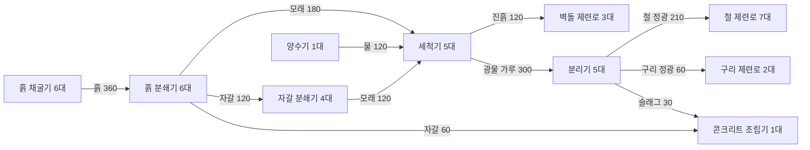

# 흙 공정 전체 수지와 분기 비율

2026-11-06 · **사용자 채택 후 게임 데이터에 적용한 수치.** 변경 요약은 [흙 금속 공정 개정](흙-금속-밸런스.md)을 따른다. 계산은 `node scripts/audit-soil-chain.mjs`로 재현한다.

## 기준과 결론

일반 채굴기, 평시 양수량, 충분한 전력, 속도 연구·설비 모듈 없음, 완제품 출구가 열려 있는 상태를 기준으로 한다. 여기서 “정확히 맞는다”는 **가동이 안정된 뒤 모든 생산 설비가 100% 가동하며 중간재의 분당 생산량과 소비량이 같은 것**이다. 초기 배치 준비와 운송 시간 때문에 순간 재고까지 항상 0이라는 뜻은 아니다.

직전 작업본의 레시피로 철판·구리판·벽돌·콘크리트까지 모두 처리하고, 콘크리트용 자갈도 흙에서 가져오면 최소 정수 조합은160대였다.

**세척과 콘크리트 두 레시피를 조정해40대가 가장 작은 완전 가동 묶음이 됐다.** 홀수 설비 수를 허용하고 철:구리:슬래그7:2:1을 유지한다. 설비별 전력과 나머지 레시피는 유지한다. 이 숫자는 효율을 계산하기 위한 예시다. 건설 대수·배치를 제한하지 않으며, 필요한 생산량에 맞춰 작은 공장으로 시작하거나 다른 라인과 재료를 공유할 수 있다.

## 적용한 변경 두 곳

| 레시피 | 직전 작업본 | 현재 적용값 |
|---|---|---|
| 일반 세척 | 모래2 + 물1 → 광물 가루2 + 진흙1 / 2초 | **모래5 + 물2 → 광물 가루5 + 진흙2 / 5초** |
| 콘크리트 | 슬래그2 + 자갈1 → 콘크리트1 / 3초 | **슬래그1 + 자갈2 → 콘크리트1 / 2초** |

세척기의 모래·광물 가루 처리량은 분당60 그대로다. 물 소비와 진흙 산출을 각각30에서24로 맞추면 양수기1대와 세척기5대, 벽돌 제련로3대가 맞는다. 콘크리트는 자갈을 골재로 충분히 사용해 흙 분쇄의 자갈을 금속과 건설 재료 양쪽으로 나눈다.

금속 산출 비율은 그대로지만, 같은 세척기5대를 기준으로 진흙·벽돌 생산은20% 줄고 슬래그당 콘크리트 수율은2배가 된다. 이를 추가 금속 생산으로 계산하지 않는다. 황산 세척은 이번 두 레시피 조정에서 변경하지 않았다.

## 설비 한 대의 정격 처리량

아래는 **현재 적용된** 수치다. 단위는 모두 개/분이다.

| 설비·설정 | 1회 재료 → 결과 | 시간 | 소비/분 | 생산/분 |
|---|---|---:|---|---|
| 일반 흙 채굴기 | 흙1 | 1초 | — | 흙60 |
| 양수기 | 물1 | 0.5초 | — | 물120 |
| 흙 분쇄기 | 흙2 → 자갈1 + 모래1 | 2초 | 흙60 | 자갈30 + 모래30 |
| 자갈 분쇄기 | 자갈1 → 모래1 | 2초 | 자갈30 | 모래30 |
| 일반 세척기 | 모래5 + 물2 → 가루5 + 진흙2 | 5초 | 모래60 + 물24 | 가루60 + 진흙24 |
| 분리기 | 가루10 → 철 정광7 + 구리 정광2 + 슬래그1 | 10초 | 가루60 | 철 정광42 + 구리 정광12 + 슬래그6 |
| 철 정광 제련로 | 정광1 → 철판1 | 2초 | 철 정광30 | 철판30 |
| 구리 정광 제련로 | 정광1 → 구리판1 | 2초 | 구리 정광30 | 구리판30 |
| 벽돌 제련로 | 진흙2 → 벽돌1 | 3초 | 진흙40 | 벽돌20 |
| 콘크리트 조립기 | 슬래그1 + 자갈2 → 콘크리트1 | 2초 | 슬래그30 + 자갈60 | 콘크리트30 |

## 전체 정수 조합

| 공정 | 대수 | 합계 소비/분 | 합계 생산/분 |
|---|---:|---|---|
| 흙 채굴 | **6** | — | 흙360 |
| 흙 분쇄 | **6** | 흙360 | 자갈180 + 모래180 |
| 자갈 분쇄 | **4** | 자갈120 | 모래120 |
| 양수 | **1** | — | 물120 |
| 세척 | **5** | 모래300 + 물120 | 광물 가루300 + 진흙120 |
| 광물 분리 | **5** | 광물 가루300 | 철 정광210 + 구리 정광60 + 슬래그30 |
| 철판 제련 | **7** | 철 정광210 | 철판210 |
| 구리판 제련 | **2** | 구리 정광60 | 구리판60 |
| 벽돌 제련 | **3** | 진흙120 | 벽돌60 |
| 콘크리트 조립 | **1** | 슬래그30 + 자갈60 | 콘크리트30 |
| 합계 | **40** | 흙·물부터 내부 생산 | **철판210 + 구리판60 + 벽돌60 + 콘크리트30** |

기존 제련로가 정광을 분당30개씩 쓰므로 분리기5대가 철 제련로7대·구리 제련로2대에 정확히 대응한다. 세척기5대는 물120과 진흙120을 기준으로 양수기1대·벽돌 제련로3대에 대응한다. 이 조합이 짝수 대수로 강제하지 않고 작은 정수비를 쓰는 이유다.

## 분기에서 중복 계산하지 않을 것

| 품목 | 생산/분 | 분기 소비/분 | 남는 중간재 |
|---|---:|---|---:|
| 흙 | 360 | 흙 분쇄360 | 0 |
| 자갈 | 180 | 모래용120 + 콘크리트용60 | 0 |
| 모래 | 180 + 120 = 300 | 세척300 | 0 |
| 물 | 120 | 세척120 | 0 |
| 광물 가루 | 300 | 분리300 | 0 |
| 진흙 | 120 | 벽돌120 | 0 |
| 철 정광 | 210 | 철판210 | 0 |
| 구리 정광 | 60 | 구리판60 | 0 |
| 슬래그 | 30 | 콘크리트30 | 0 |

자갈은 **모래 쪽 2 : 콘크리트 쪽 1**이 분당 목표 분기다. 흙 분쇄의 혼합 출력은 분류기로 모래와 자갈을 나누고, 자갈은 콘크리트 재료를 우선 채운 뒤 남는 양을 재분쇄하는 식으로 기존 우선 분배기를 활용할 수 있다. 생산량 비율이지 새 분배 비율 설정 기능을 뜻하지 않는다.

이 묶음에서 다른 지역으로 내보낼 완제품은 철판210·구리판60·벽돌60·콘크리트30이다. 물·모래·자갈·진흙·가루·슬래그를 추가로 빼 쓰면 그만큼 본선에 부족하므로 별도 공급을 계산해야 한다. 완제품 수령 창고나 다른 생산라인도 이 양을 계속 받아야 완전 가동한다.

## 다른 생산라인에 보내는 물

본선 양수기1대의 물120은 전부 세척에 사용한다. 아래 수요는 **추가 설비 한 대가 100% 가동할 때 별도로 필요한 물**이다. 해당 제품의 다른 재료도 따로 공급한다.

| 추가 공정 | 직접 물 소비/분 | 함께 확인할 상류 |
|---|---:|---|
| 종이 | 30 | 톱밥60/분 |
| 플라스틱 | 15 | 원유45/분 |
| 알루미늄판 | 10 | 보크사이트20/분 |
| 황산 | 30 | 황15/분 |
| 리튬 | 20 | 염수40/분 |
| 황산 세척 | 30 | 황산15/분을 자체 생산하면 물15/분 추가, **총45** |
| 수력 발전기 | **실제 출력kW ÷ 5** | 정격600kW 가동 시 물120/분 |

예를 들어 추가 양수기1대의120을 **종이1대30 + 플라스틱2대30 + 알루미늄1대10 + 황산1대30 + 리튬1대20**으로 나누면 정확히 맞는다. 기본 공장의 물을 함께 쓰는 것으로 중복 계산하지 않는다. 황산 생산용 물을 이 표의 황산 항목으로 이미 계산했다면 황산 세척의 상류 물을 다시 더하지 않는다.

수력 발전용 물도 생산용 물과 별도다. 양수기1대를 세척5대와 정격 수력 발전기1대에 동시에 연결하면 수요240에 공급120이므로 부족하다.

양수기는 평시120, 비·폭풍이 완전히 적용되면144/분이다. 평시120을 기준으로 배치한다. 비에 늘어난24는 여유 공급이며, 이를 상시 생산량으로 계산하지 않는다. 효과가 바뀌는 동안에는 그 사이 값이다.

## 금속을 다른 생산라인에 배분할 때

철판210·구리판60은 이 공장의 총 출력이다. 아래 표는 외부 공정 한 대의 직접 수요이며, 원하는 공정의 수요를 합쳐 이 예산 안에서 배분한다.

| 공정 1대 | 이 공장에서 받는 것/분 | 다른 필요한 것/분 | 생산/분 |
|---|---|---|---|
| 강철 | 철판24 | 석탄12 또는 숯12 | 강철12 |
| 기어 | 철판40 | — | 기어20 |
| 회로 | 철판12 | 구리선36 | 회로12 |
| 구리선 | 구리판40 | — | 구리선80 |
| 청동 | 구리판45 | 주석판15 | 청동60 |
| 배터리 팩 | 구리판20 | 리튬20 + 회로10 + 플라스틱10 | 배터리 팩10 |

예를 들어 구리선1대에 구리판40을 보내면 나머지는20이므로 배터리 팩1대의 구리 수요까지 맞는다. 이 구리선80 가운데 회로2대가72를 쓰면8이 다른 공정용으로 남는다. 구리판60을 청동용60과 구리선용60으로 각각 잡는 식의 이중 배분을 피한다.

## 황산 세척을 선택하면 다시 계산

현재 고효율 세척 한 대는 모래60 + 물30 + 황산15를 사용해 가루120 + 진흙30/분을 만든다. 일반 세척과 투입·부산물 비율이 다르다.

위 기본 공장의 세척5대를 그대로 고효율로 바꾸면:

- 가루600 → 분리기10대 → 철 정광420·구리 정광120·슬래그60/분.
- 슬래그60을 전부 콘크리트로 바꾸려면 콘크리트2대와 자갈120/분 필요. 기본 공장의 예약 자갈은60이라 **추가60**이 필요하다.
- 진흙150/분 → 벽돌75/분. 기존 벽돌 제련로3대의 진흙 처리량120을 넘으므로 추가 처리 용량 필요.
- 직접 물150 + 황산75 생산용 물75 = **물225/분**. 기본 양수량120을 초과한다. 황은37.5/분이 별도로 필요하다.

따라서 고효율 세척은 같은 자리에 레시피만 바꿔서 모든 분기 비율이 유지되는 업그레이드가 아니다. 모래 절감 또는 금속 증산을 선택한 뒤 부산물·황산·물 공급도 함께 증설하는 확장 경로로 다룬다.

## 전력과 검증 범위

40대의 정격 소비 합계는 **5,205kW**다. 채굴540 + 분쇄1,200 + 세척750 + 분리1,500 + 철·구리·벽돌 제련1,080 + 조립75 + 양수60. 발전 설비, 타라인 설비, 그쪽 물 공급은 별도다. 각 설비의 기존 소비 전력은 유지한다.

계산 스크립트는 게임의 `RECIPES`를 직접 읽어 최소 정수 조합을 탐색하고, 중간재9종의 공급-소비가0인지, 최종 출력이210·60·60·30인지, 물 분기와 황산의 상류 물이 중복되지 않는지 검사한다. 이는 레시피 수지 검증이며, 실제 벨트 배치·기동 시간·운송 정체를 검증한 플레이 결과는 아니다. 전체 공정의 실제 틱과 기존 저장 이행은 시뮬레이션 테스트로 별도 확인한다.

`src/sim/soil-balance.test.ts`에서 40대를 180초 가동한 뒤 300초 동안 측정한 결과, 철판1,050·구리판300·벽돌300·콘크리트150개를 생산했고 평균 소비 전력은5,205kW였다. 중간재9종의 잔고는 측정 전후 같았다. 벽돌·콘크리트 출구가 막히면 상류도 멈추고, 다시 열면 정상 생산량으로 회복한다. 제작 중 저장·재개도 같은 결과를 낸다. 이 검증은 실제 제작 틱과 입고 용량을 사용하되 설비 사이 운송은 재료를 보존하는 즉시 이동으로 대신하므로, 벨트 처리량과 배치 거리는 별도로 확보해야 한다.

기존 저장에서 바뀐 레시피가 제작 중이면 옛 작업이 실제로 사용한 재료만 입고 칸으로 돌려주고 새 레시피를 준비한다. 이미 나온 완제품과 남은 입고 재고는 보존한다. 새 저장을 다시 열 때 재료를 중복 반환하지 않는다.
